# DIMS 后端接口详情（前端开发文档）

> 版本：v1.0 | 基于 DIMS Phase 1 代码 + 集成测试数据 | 更新日期：2026-07-26

---

## 1. 接口总览

| 模块 | 方法 | 路径 | 功能 | 对应前端页面 |
|------|------|------|------|-------------|
| 数据接入 | POST | `/v1/data-slices` | 上传 ROS1 bag 文件，创建数据切片 | 数据上传页 |
| 数据接入 | GET | `/v1/tasks/{taskId}` | 查询导入任务进度和状态 | 数据上传页（轮询） |
| 切片检索 | GET | `/v1/data-slices` | 多条件检索（分页） | 切片管理列表页 |
| 切片检索 | GET | `/v1/data-slices/{sliceId}` | 切片详情（含 SensorStream 列表） | 切片详情页 |
| 切片检索 | DELETE | `/v1/data-slices/{sliceId}` | 删除切片 | 切片管理列表页 / 详情页 |
| 数据导出 | POST | `/v1/data-slices/{sliceId}/exports` | 创建导出任务 | 详情页导出区 |
| 数据导出 | GET | `/v1/exports/{exportId}` | 查询导出状态和下载链接 | 详情页（轮询导出进度） |
| 标签管理 | GET | `/v1/tags` | 标签库列表（支持分类过滤） | 标签管理页 / 标签选择器 |
| 标签管理 | POST | `/v1/tags` | 创建标签 | 标签管理页（新建弹窗） |
| 标签管理 | PUT | `/v1/tags/{tagId}` | 修改标签 | 标签管理页（编辑弹窗） |
| 标签管理 | DELETE | `/v1/tags/{tagId}` | 删除标签 | 标签管理页 |
| 标签管理 | PUT | `/v1/data-slices/{sliceId}/tags` | 批量设置切片标签（覆盖式更新） | 详情页标签编辑区 |
| 标签管理 | GET | `/v1/data-slices/{sliceId}/tags` | 查询切片当前关联的标签 | 详情页标签展示区 |
| 系统 | GET | `/v1/health` | 健康检查 | 全局（运维 / 网关健康检测） |

---

## 2. 通用约定

### 2.1 基础 URL

- 开发环境：`http://localhost:8080/v1`
- 生产环境（网关）：`https://gateway.isim.internal/dims/v1`

### 2.2 认证方式

请求头携带 IAMS 签发的 Bearer Token：

```
Authorization: Bearer <token>
```

### 2.3 链路追踪

请求头透传 `X-Trace-Id`（UUID 字符串）。后端返回的错误结构中会携带该 ID 用于排查。

```
X-Trace-Id: <uuid>
```

若前端未传递，后端自动生成 `auto-generated`。

### 2.4 统一错误结构

所有错误响应（4xx / 5xx）采用以下格式（符合平台宪法第 7 节）：

```json
{
  "error": {
    "code": "ERROR_CODE",
    "message": "人类可读的错误描述",
    "trace_id": "请求头 X-Trace-Id 的值"
  }
}
```

错误码一览：

| 错误码 | 触发场景 |
|--------|---------|
| `UPLOAD_FAILED` | 上传文件保存失败 |
| `SEARCH_FAILED` | 检索查询异常 |
| `SLICE_NOT_FOUND` | 切片 ID 不存在 |
| `EXPORT_FAILED` | 创建导出任务失败 |
| `EXPORT_NOT_FOUND` | 导出任务 ID 不存在 |
| `TASK_NOT_FOUND` | 导入任务 ID 不存在 |
| `TAG_LIST_FAILED` | 标签列表查询失败 |
| `TAG_CREATE_FAILED` | 标签创建失败 |
| `TAG_UPDATE_FAILED` | 标签更新失败 |
| `TAG_DELETE_FAILED` | 标签删除失败 |
| `SLICE_TAGS_FAILED` | 切片标签查询失败 |
| `SLICE_TAGS_SET_FAILED` | 切片标签设置失败 |

### 2.5 分页规范

分页参数适用于 `GET /v1/data-slices`：

| 参数 | 类型 | 默认值 | 说明 |
|------|------|--------|------|
| `page` | int | 1 | 页码，从 1 开始 |
| `page_size` | int | 50 | 每页条数，最大 500 |

分页响应结构：

```json
{
  "items": [ ... ],
  "total": 42,
  "page": 1,
  "page_size": 50
}
```

### 2.6 时间格式

所有跨系统时间使用 **UTC RFC3339** 格式：`2026-07-24T09:00:00Z`

### 2.7 ID 格式

所有实体 ID 使用 **字符串 UUID** 格式，如 `f9096174-f205-4979-8142-f0048f00d0c1`

### 2.8 JSON 字段命名

后端全局配置 `jackson.property-naming-strategy: SNAKE_CASE`，所有请求体和响应体字段使用 **snake_case** 命名。

示例：
```
Java 字段名      → JSON 字段名
fileSize        → file_size
durationMs      → duration_ms
startTs         → start_ts
sensorTypes     → sensor_types
msgCountTotal   → msg_count_total
downloadUrl     → download_url
createdAt       → created_at
exportId        → export_id
frequencyHz     → frequency_hz
firstTs         → first_ts
ruleExpr        → rule_expr
tagIds          → tag_ids
```

### 2.9 文件上传限制

| 配置项 | 值 |
|--------|-----|
| max-file-size | 500MB |
| max-request-size | 500MB |

---

## 3. 各接口详细说明

---

### 3.1 POST /v1/data-slices — 上传 ROS1 bag 文件

#### 基本信息

| 项 | 值 |
|----|-----|
| 方法 | `POST` |
| 路径 | `/v1/data-slices` |
| Content-Type | `multipart/form-data` |
| 成功状态码 | `202 Accepted` |
| 错误状态码 | `500`（上传失败） |

#### 请求参数

| 参数名 | 位置 | 类型 | 必填 | 说明 | 示例 |
|--------|------|------|------|------|------|
| `file` | form-data | Binary | 是 | ROS1 bag 文件（.bag），最大 500MB | `mapping_input.bag` |
| `name` | form-data | String | 否 | 切片名称，默认取文件名（不含扩展名） | `上海外环采集车01` |
| `X-Trace-Id` | header | String | 否 | 链路追踪 ID | `integration-test-1785055101` |

#### 响应示例

**成功 202**：
```json
{
  "slice_id": "f9096174-f205-4979-8142-f0048f00d0c1",
  "task_id": "f0426fb2-9f9a-4be4-b28c-977381597c96",
  "status": "UPLOADING"
}
```

**失败 500**：
```json
{
  "error": {
    "code": "UPLOAD_FAILED",
    "message": "Failed to save bag file for sliceId=...",
    "trace_id": "auto-generated"
  }
}
```

#### 数据处理流程

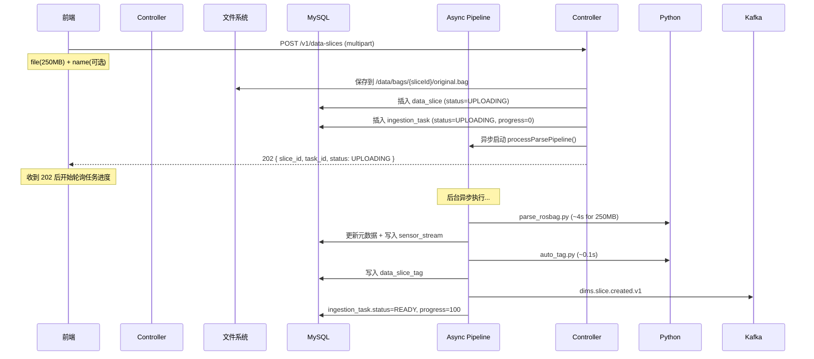

#### 前端交互建议

- **上传进度展示**：文件可能 250MB+，使用 `el-upload` 组件的 `on-progress` 回调展示实时上传进度百分比。后端 500MB 限制，前端也做一层文件大小校验（超 500MB 提示"单文件最大 500MB"）。
- **上传完成后的处理**：收到 202 响应后，立即保存 `task_id` 到前端状态，启动轮询 `GET /v1/tasks/{taskId}`。
- **错误提示**：
  - 文件大小超限 → "文件大小超过 500MB 限制，请压缩后重新上传"
  - 非 bag 文件上传失败 → "上传失败，仅支持 .bag 格式文件"
  - 通用失败 → "上传失败，请稍后重试"
- **页面状态机**：
  ```
  空闲 → 上传中(进度%) → 已提交(202收到) → 轮询中 → 完成(状态=READY) → 跳转详情
                                                                    → 失败(状态=ERROR) → 显示错误信息
  ```
- **文件选择限制**：`el-upload` 的 `accept=".bag"` 限制文件选择类型。

---

### 3.2 GET /v1/tasks/{taskId} — 查询导入任务进度

#### 基本信息

| 项 | 值 |
|----|-----|
| 方法 | `GET` |
| 路径 | `/v1/tasks/{taskId}` |
| 成功状态码 | `200 OK` |
| 错误状态码 | `500`（任务不存在） |

#### 请求参数

| 参数 | 位置 | 类型 | 必填 | 说明 |
|------|------|------|------|------|
| `taskId` | path | String | 是 | 导入任务 UUID（从上传接口返回的 `task_id` 获取） |
| `X-Trace-Id` | header | String | 否 | 链路追踪 ID |

#### 响应示例

**成功 200（轮询中）**：
```json
{
  "task_id": "f0426fb2-9f9a-4be4-b28c-977381597c96",
  "slice_id": "f9096174-f205-4979-8142-f0048f00d0c1",
  "status": "PARSING",
  "progress": 30,
  "error_msg": null
}
```

**成功 200（解析完成）**：
```json
{
  "task_id": "f0426fb2-9f9a-4be4-b28c-977381597c96",
  "slice_id": "f9096174-f205-4979-8142-f0048f00d0c1",
  "status": "READY",
  "progress": 100,
  "error_msg": null
}
```

**成功 200（失败）**：
```json
{
  "task_id": "f0426fb2-9f9a-4be4-b28c-977381597c96",
  "slice_id": "f9096174-f205-4979-8142-f0048f00d0c1",
  "status": "ERROR",
  "progress": 0,
  "error_msg": "Python parse_rosbag.py failed with exit code 1..."
}
```

**失败 500**：
```json
{
  "error": {
    "code": "TASK_NOT_FOUND",
    "message": "TASK_NOT_FOUND: ...",
    "trace_id": "auto-generated"
  }
}
```

#### 状态流转图

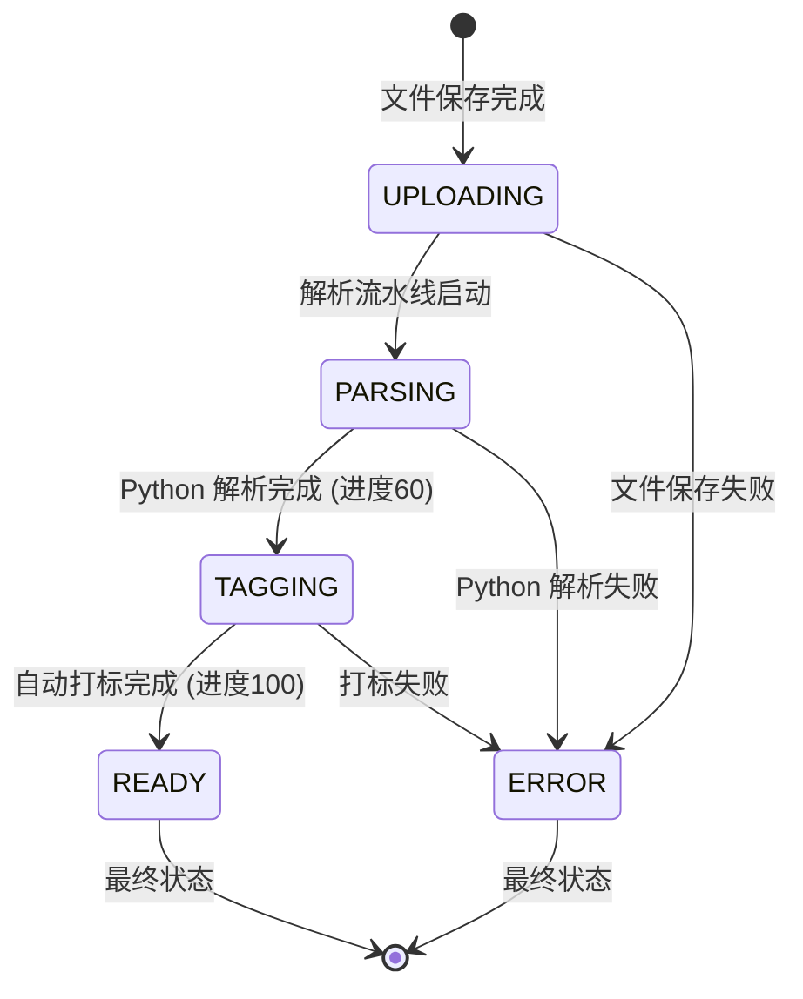

#### 前端交互建议

- **轮询策略**：
  - 间隔：每 2 秒轮询一次
  - 退避：连续 3 次无状态变化，间隔增加至 5 秒
  - 终止条件：`status === "READY"` 或 `status === "ERROR"` 或 总超时 600 秒（10 分钟）
  - 超时处理：超过 600 秒显示"处理超时，请联系管理员"
- **进度展示**：使用 `el-progress` 组件，`progress` 字段对应百分比值。状态文字映射：
  - `UPLOADING` → "文件保存中"
  - `PARSING` → "解析中（解析 ROS bag 元数据）"
  - `TAGGING` → "自动打标中"
  - `READY` → "就绪"
  - `ERROR` → "处理失败"
- **错误处理**：`error_msg` 字段展示给用户，如"解析失败：xxx"。建议用 `el-alert` 组件显示。
- **跳转时机**：状态变为 `READY` 后，跳转至切片详情页 `/slices/{slice_id}`。

---

### 3.3 GET /v1/data-slices — 多条件检索数据切片

#### 基本信息

| 项 | 值 |
|----|-----|
| 方法 | `GET` |
| 路径 | `/v1/data-slices` |
| 成功状态码 | `200 OK` |
| 错误状态码 | `500`（查询失败） |

#### 请求参数（Query）

| 参数 | 类型 | 必填 | 默认值 | 说明 |
|------|------|------|--------|------|
| `start_ts` | string(date-time) | 否 | - | 数据起始时间（含），UTC RFC3339，如 `2026-07-24T09:00:00Z` |
| `end_ts` | string(date-time) | 否 | - | 数据结束时间（含），UTC RFC3339 |
| `sensor_types` | string | 否 | - | 逗号分隔，如 `camera,radar,gnss_imu` |
| `tags` | string | 否 | - | 逗号分隔的标签名，须全部匹配，如 `夜间场景,全传感器` |
| `lat` | number | 否 | - | 中心纬度（配合 `lon` + `radius` 使用），WGS84 |
| `lon` | number | 否 | - | 中心经度，WGS84 |
| `radius` | integer | 否 | - | 搜索半径（米） |
| `keyword` | string | 否 | - | 文件名/备注模糊搜索 |
| `status` | string | 否 | - | 切片状态过滤：`READY` / `ERROR` |
| `page` | integer | 否 | 1 | 页码（>=1） |
| `page_size` | integer | 否 | 50 | 每页条数（<=500） |
| `sort` | string | 否 | `created_at:desc` | 排序表达式，格式 `field:direction`，允许的 field：`created_at`, `start_ts`, `end_ts`, `file_size`, `name` |

#### 响应示例

**成功 200**：
```json
{
  "items": [
    {
      "id": "f9096174-f205-4979-8142-f0048f00d0c1",
      "name": "integration-test-1785055101",
      "file_size": 249736672,
      "duration_ms": 29996,
      "start_ts": "2026-07-09T03:16:41Z",
      "end_ts": "2026-07-09T03:17:11Z",
      "gps_bbox": {
        "min_lat": 31.23,
        "min_lon": 121.47,
        "max_lat": 31.25,
        "max_lon": 121.50
      },
      "sensor_types": ["vehicle_signal", "other", "adas", "radar", "camera", "gnss_imu", "ultrasonic"],
      "msg_count_total": 16527,
      "tags": ["夜间场景", "全传感器"],
      "status": "READY",
      "download_url": "/v1/data-slices/f9096174-f205-4979-8142-f0048f00d0c1/exports",
      "created_at": "2026-07-26T08:38:34Z"
    }
  ],
  "total": 1,
  "page": 1,
  "page_size": 50
}
```

**失败 500**：
```json
{
  "error": {
    "code": "SEARCH_FAILED",
    "message": "...",
    "trace_id": "auto-generated"
  }
}
```

#### 数据处理流程

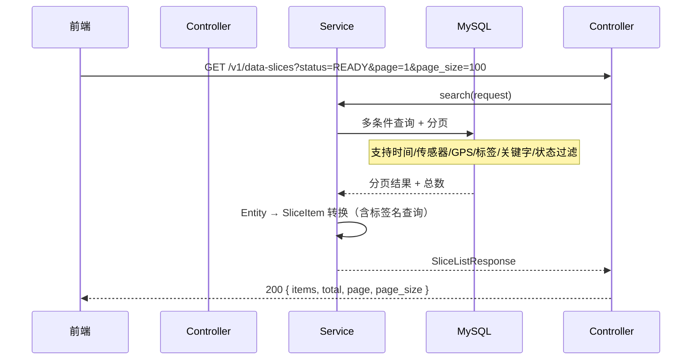

#### 前端交互建议

- **检索面板设计**：参考 DEVELOPMENT.md#5.7 前端模块，构建 ElForm 作为检索面板：
  - 时间范围：`el-date-picker` type="datetimerange"
  - 传感器类型：`el-select` multiple（选项固定为 camera/lidar/radar/gnss_imu/vehicle_signal/ultrasonic/adas/other）
  - 标签过滤：`el-select` multiple 或 `el-tag` 点选（标签数据从 GET /v1/tags 获取）
  - 关键字：`el-input` placeholder="搜索文件名/备注"
  - GPS 范围（可选）：Phase 2 集成 Leaflet 地图圈选
  - 搜索/重置按钮
- **表格展示**：使用 `el-table`，列推荐：名称 / 传感器图标 / 时间范围 / 时长 / 标签 / 文件大小 / 状态 / 操作
- **分页**：`el-pagination` 绑定 `page` 和 `page_size`，`total` 显示总条数
- **排序**：点击表头排序（如按创建时间、文件大小排序），调用接口传入 `sort=field:asc|desc`
- **空状态**：`el-empty` 组件，文案"暂无数据"
- **状态列**：使用 `el-tag` 显示状态，颜色映射：
  - READY → `success`
  - ERROR → `danger`
  - UPLOADING / PARSING / TAGGING → `warning`
- **数据加载状态**：`v-loading` 指令在表格上，避免重复请求

---

### 3.4 GET /v1/data-slices/{sliceId} — 获取切片详情

#### 基本信息

| 项 | 值 |
|----|-----|
| 方法 | `GET` |
| 路径 | `/v1/data-slices/{sliceId}` |
| 成功状态码 | `200 OK` |
| 错误状态码 | `500`（切片不存在） |

#### 请求参数

| 参数 | 位置 | 类型 | 必填 | 说明 |
|------|------|------|------|------|
| `sliceId` | path | String | 是 | 切片 UUID |
| `X-Trace-Id` | header | String | 否 | 链路追踪 ID |

#### 响应示例

**成功 200**：
```json
{
  "id": "f9096174-f205-4979-8142-f0048f00d0c1",
  "name": "integration-test-1785055101",
  "file_size": 249736672,
  "duration_ms": 29996,
  "start_ts": "2026-07-09T03:16:41Z",
  "end_ts": "2026-07-09T03:17:11Z",
  "gps_bbox": {
    "min_lat": 31.23,
    "min_lon": 121.47,
    "max_lat": 31.25,
    "max_lon": 121.50
  },
  "sensor_types": ["vehicle_signal", "other", "adas", "radar", "camera", "gnss_imu", "ultrasonic"],
  "msg_count_total": 16527,
  "tags": ["夜间场景", "全传感器"],
  "status": "READY",
  "download_url": "/v1/data-slices/f9096174-f205-4979-8142-f0048f00d0c1/exports",
  "created_at": "2026-07-26T08:38:34Z",
  "streams": [
    {
      "id": "stream-uuid-1",
      "topic": "/sensor/ultrasonic/obstacle",
      "msg_type": "ultrasonic_interface_msgs/Obstacle",
      "sensor_category": "ultrasonic",
      "msg_count": 750,
      "frequency_hz": 25.0,
      "first_ts": "2026-07-09T03:16:41Z",
      "last_ts": "2026-07-09T03:17:11Z"
    },
    {
      "id": "stream-uuid-2",
      "topic": "/sensor/camera_front_wide/video",
      "msg_type": "sensor_interface_msgs/CompressedVideo",
      "sensor_category": "camera",
      "msg_count": 300,
      "frequency_hz": 10.0,
      "first_ts": "2026-07-09T03:16:41Z",
      "last_ts": "2026-07-09T03:17:11Z"
    }
  ]
}
```

**失败 500**：
```json
{
  "error": {
    "code": "SLICE_NOT_FOUND",
    "message": "SLICE_NOT_FOUND: ...",
    "trace_id": "auto-generated"
  }
}
```

#### 数据处理流程

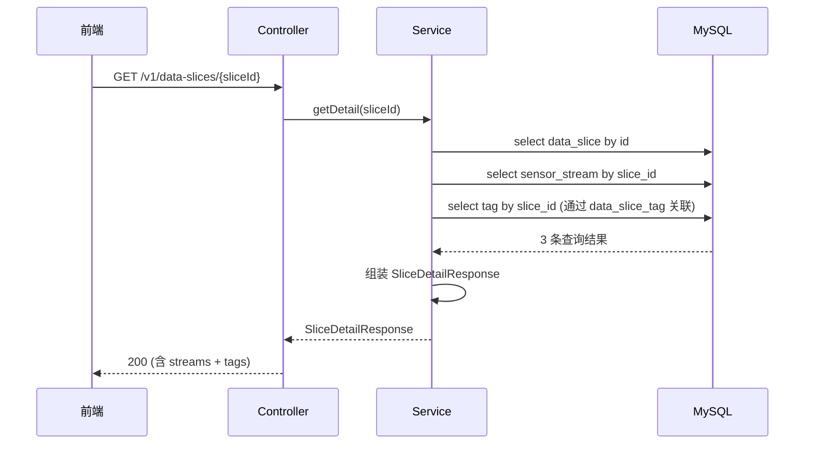

#### 前端交互建议

- **页面布局**：使用 `el-descriptions` 展示基础元数据，包括文件大小、时长、时间范围、消息总数等
- **传感器流列表**：使用 `el-table` 展示，列建议：
  - Topic（完整路径）
  - 传感器类别（`el-tag` 显示 camera/radar 等）
  - 消息类型
  - 消息数
  - 频率（Hz）
- **标签展示**：使用 `el-tag` 可关闭标签（`closable`），点击删除触发标签编辑
- **GPS 展示**（Phase 2）：集成 Leaflet 地图展示 `gps_bbox` 范围
- **数据格式化**：
  - `file_size`：转换为 MB/GB 显示（249,736,672 bytes ≈ 238 MB）
  - `duration_ms`：转换为秒或分钟显示（29996ms ≈ 30 秒）
  - `frequency_hz`：保留 1 位小数
- **加载状态**：`v-loading` 指令
- **错误处理**：404 时跳转到列表页，并提示"切片不存在或已被删除"

---

### 3.5 DELETE /v1/data-slices/{sliceId} — 删除切片

#### 基本信息

| 项 | 值 |
|----|-----|
| 方法 | `DELETE` |
| 路径 | `/v1/data-slices/{sliceId}` |
| 成功状态码 | `204 No Content` |
| 错误状态码 | `500`（切片不存在） |

#### 请求参数

| 参数 | 位置 | 类型 | 必填 | 说明 |
|------|------|------|------|------|
| `sliceId` | path | String | 是 | 切片 UUID |
| `X-Trace-Id` | header | String | 否 | 链路追踪 ID |

#### 响应

**成功 204**：无响应体

**失败 500**：
```json
{
  "error": {
    "code": "SLICE_NOT_FOUND",
    "message": "SLICE_NOT_FOUND: ...",
    "trace_id": "auto-generated"
  }
}
```

#### 数据处理流程

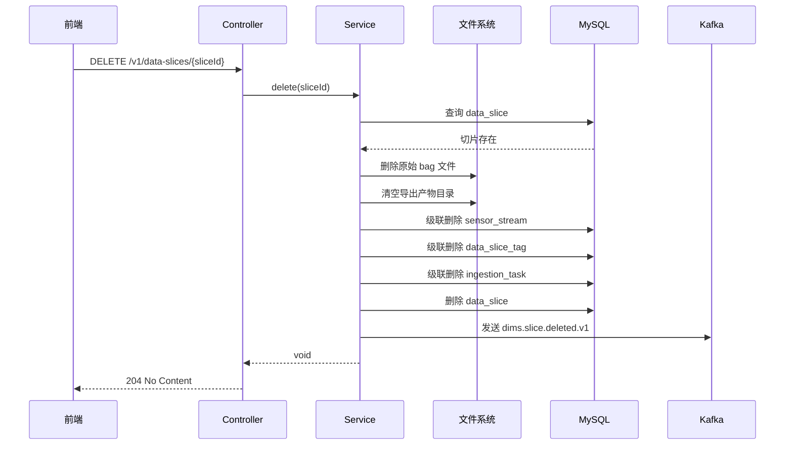

#### 前端交互建议

- **确认弹窗**：删除前使用 `ElMessageBox.confirm` 确认，文案示例："确定要删除切片「{name}」吗？删除后不可恢复。"
- **权限控制**：仅展示删除按钮给有权限的用户
- **删除后行为**：若当前在详情页，删除成功后跳回列表页；若在列表页，刷新列表并提示"删除成功"
- **级联说明**：可提示用户"删除后将同时移除关联的 29 条传感器流记录和标签"
- **错误处理**：提示"删除失败，请稍后重试"

---

### 3.6 POST /v1/data-slices/{sliceId}/exports — 创建导出任务

#### 基本信息

| 项 | 值 |
|----|-----|
| 方法 | `POST` |
| 路径 | `/v1/data-slices/{sliceId}/exports` |
| Content-Type | `application/json` |
| 成功状态码 | `202 Accepted` |
| 错误状态码 | `500`（导出创建失败） |

#### 请求参数

| 参数 | 位置 | 类型 | 必填 | 说明 |
|------|------|------|------|------|
| `sliceId` | path | String | 是 | 切片 UUID |
| `X-Trace-Id` | header | String | 否 | 链路追踪 ID |

请求体字段：

| 字段 | 类型 | 必填 | 默认值 | 说明 |
|------|------|------|--------|------|
| `start_ts` | string(date-time) | 是 | - | 导出时间窗口起点，UTC RFC3339，不能早于切片的 `start_ts` |
| `end_ts` | string(date-time) | 是 | - | 导出时间窗口终点，UTC RFC3339，不能晚于切片的 `end_ts` |
| `topics` | string[] | 否 | 全部导出 | 要导出的 Topic 列表，为空则导出全部 |
| `format` | string | 否 | `bag` | 导出格式，Phase 1 仅支持 `bag` |

#### 请求示例

```json
{
  "start_ts": "2026-07-09T03:16:41Z",
  "end_ts": "2026-07-09T03:17:11Z",
  "format": "bag"
}
```

#### 响应示例

**成功 202**：
```json
{
  "export_id": "cce07ea1-7adf-4f2e-b176-c4e8117fed04",
  "status": "PENDING",
  "format": "bag"
}
```

**失败 500**：
```json
{
  "error": {
    "code": "EXPORT_FAILED",
    "message": "...",
    "trace_id": "auto-generated"
  }
}
```

#### 数据处理流程

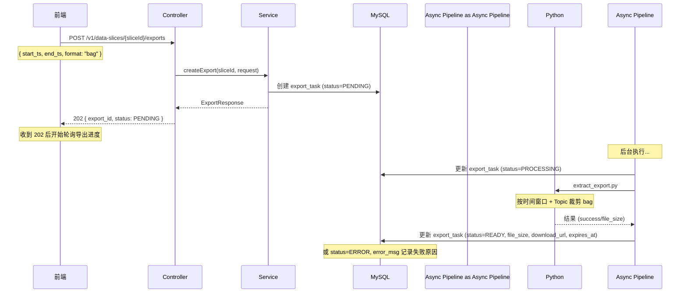

#### 前端交互建议

- **时间窗口选择**：使用 `el-date-picker` type="datetimerange"，限制范围不能超切片的 `start_ts` ~ `end_ts`。默认选中切片完整时间范围。
- **Topic 选择**：使用 `el-select` multiple，选项从详情接口返回的 `streams[].topic` 获取。可提供"全选/取消"快捷按钮。
- **导出按钮状态**：导出过程中禁用按钮，防止重复提交
- **轮询导出结果**：同导入任务轮询策略，见 3.2 节
- **缓存复用说明**：相同参数短时间内重复请求会复用已有导出产物，后端自动处理，前端无需缓存逻辑
- **错误提示**：导出失败时展示 `error_msg`。已知限制：Python 层对自定义 ROS 消息类型兼容性有限，若导出包含 `perception_interface_msgs` 等自定义类型可能失败。

---

### 3.7 GET /v1/exports/{exportId} — 查询导出任务状态

#### 基本信息

| 项 | 值 |
|----|-----|
| 方法 | `GET` |
| 路径 | `/v1/exports/{exportId}` |
| 成功状态码 | `200 OK` |
| 错误状态码 | `500`（导出任务不存在） |

#### 请求参数

| 参数 | 位置 | 类型 | 必填 | 说明 |
|------|------|------|------|------|
| `exportId` | path | String | 是 | 导出任务 UUID（从创建接口返回的 `export_id` 获取） |
| `X-Trace-Id` | header | String | 否 | 链路追踪 ID |

#### 响应示例

**成功 200（PENDING）**：
```json
{
  "export_id": "cce07ea1-7adf-4f2e-b176-c4e8117fed04",
  "slice_id": "f9096174-f205-4979-8142-f0048f00d0c1",
  "status": "PENDING",
  "format": "bag",
  "file_size": null,
  "download_url": null,
  "expires_at": null,
  "created_at": "2026-07-26T08:38:44Z"
}
```

**成功 200（就绪）**：
```json
{
  "export_id": "cce07ea1-7adf-4f2e-b176-c4e8117fed04",
  "slice_id": "f9096174-f205-4979-8142-f0048f00d0c1",
  "status": "READY",
  "format": "bag",
  "file_size": 52428800,
  "download_url": "/data/exports/cce07ea1-7adf-4f2e-b176-c4e8117fed04/output.bag",
  "expires_at": "2026-07-27T08:38:44Z",
  "created_at": "2026-07-26T08:38:44Z"
}
```

**成功 200（失败）**：
```json
{
  "export_id": "cce07ea1-7adf-4f2e-b176-c4e8117fed04",
  "slice_id": "f9096174-f205-4979-8142-f0048f00d0c1",
  "status": "ERROR",
  "format": "bag",
  "file_size": null,
  "download_url": null,
  "expires_at": null,
  "created_at": "2026-07-26T08:38:44Z"
}
```

**失败 500**：
```json
{
  "error": {
    "code": "EXPORT_NOT_FOUND",
    "message": "...",
    "trace_id": "auto-generated"
  }
}
```

#### 状态流转图

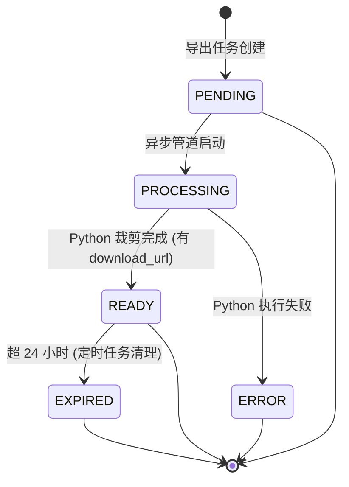

#### 前端交互建议

- **状态展示**：
  - `PENDING` → `el-tag` type="info" "等待中"
  - `PROCESSING` → `el-tag` type="warning" "导出中" + 旋转图标
  - `READY` → `el-tag` type="success" "导出完成" + 下载按钮
  - `ERROR` → `el-tag` type="danger" "导出失败" + 错误详情
  - `EXPIRED` → `el-tag` type="info" "已过期"
- **下载逻辑**：
  - `READY` 状态时，前端拿到 `download_url`，创建 `<a>` 标签触发文件下载
  - `download_url` 可能是相对路径，需拼接基础 URL
  - 24 小时过期提示："下载链接有效期为 24 小时，请及时下载"
- **导出列表**：如果页面有导出历史列表，可用 `expires_at` 判断是否过期并隐藏下载入口

---

### 3.8 GET /v1/tags — 获取标签库列表

#### 基本信息

| 项 | 值 |
|----|-----|
| 方法 | `GET` |
| 路径 | `/v1/tags` |
| 成功状态码 | `200 OK` |
| 错误状态码 | `500`（查询失败） |

#### 请求参数

| 参数 | 位置 | 类型 | 必填 | 说明 |
|------|------|------|------|------|
| `category` | query | String | 否 | 按分类路径过滤，如 `场景/道路`、`环境/光照` |
| `X-Trace-Id` | header | String | 否 | 链路追踪 ID |

#### 响应示例

**成功 200**：
```json
[
  {
    "id": "tag-001",
    "name": "highway",
    "category": "场景/道路",
    "description": "高速公路场景",
    "rule_expr": null,
    "created_at": "2026-07-25T00:00:00Z"
  },
  {
    "id": "tag-002",
    "name": "urban",
    "category": "场景/道路",
    "description": "城市道路场景",
    "rule_expr": null,
    "created_at": "2026-07-25T00:00:00Z"
  },
  {
    "id": "tag-005",
    "name": "夜间场景",
    "category": "时间",
    "description": "夜间时段采集的数据（18:00-06:00 UTC）",
    "created_at": "2026-07-25T00:00:00Z"
  },
  {
    "id": "tag-010",
    "name": "全传感器",
    "category": "传感器完整度",
    "description": "包含摄像头+雷达的完整传感器配置",
    "created_at": "2026-07-25T00:00:00Z"
  }
]
```

**失败 500**：
```json
{
  "error": {
    "code": "TAG_LIST_FAILED",
    "message": "...",
    "trace_id": "auto-generated"
  }
}
```

#### 数据处理流程

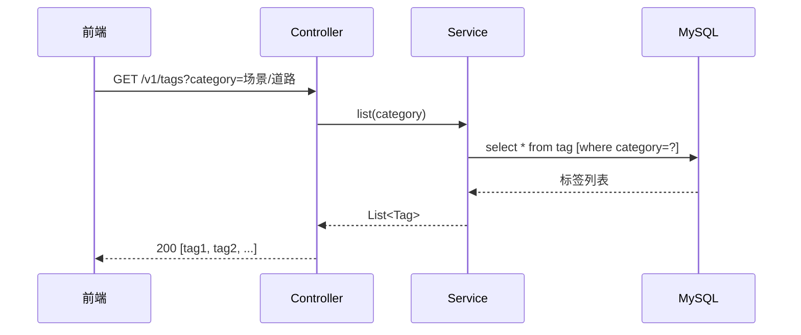

#### 前端交互建议

- **标签选择器**：在标签编辑弹窗和检索面板的标签过滤中，调用此接口获取标签选项
- **分类分组**：可对返回结果按 `category` 字段分组展示，使用 `el-option-group`
- **缓存策略**：标签库变更不频繁，可本地缓存 5 分钟，减少重复请求
- **空状态**：`el-empty` "暂无标签，请先创建"

---

### 3.9 POST /v1/tags — 创建标签

#### 基本信息

| 项 | 值 |
|----|-----|
| 方法 | `POST` |
| 路径 | `/v1/tags` |
| Content-Type | `application/json` |
| 成功状态码 | `201 Created` |
| 错误状态码 | `500`（创建失败） |

#### 请求体

| 字段 | 类型 | 必填 | 说明 |
|------|------|------|------|
| `name` | string | 是 | 标签名，如 `highway` |
| `category` | string | 是 | 分类路径，如 `场景/道路` |
| `description` | string | 否 | 标签说明 |
| `rule_expr` | string | 否 | 自动打标规则表达式（Phase 2+ DSL 预留） |

#### 请求示例

```json
{
  "name": "highway",
  "category": "场景/道路",
  "description": "高速公路场景"
}
```

#### 响应示例

**成功 201**：
```json
{
  "id": "tag-012",
  "name": "highway",
  "category": "场景/道路",
  "description": "高速公路场景",
  "rule_expr": null,
  "created_at": "2026-07-26T08:40:00Z"
}
```

**失败 500**：
```json
{
  "error": {
    "code": "TAG_CREATE_FAILED",
    "message": "...",
    "trace_id": "auto-generated"
  }
}
```

#### 前端交互建议

- **表单校验**：`name` 和 `category` 是必填，使用 `el-form` 的 `rules` 校验
- **分类输入**：`category` 建议使用 `el-select` 手动输入（allow-create），可复用已有分类
- **创建成功后**：刷新标签列表或插入新标签到本地列表

---

### 3.10 PUT /v1/tags/{tagId} — 修改标签

#### 基本信息

| 项 | 值 |
|----|-----|
| 方法 | `PUT` |
| 路径 | `/v1/tags/{tagId}` |
| Content-Type | `application/json` |
| 成功状态码 | `200 OK` |
| 错误状态码 | `500`（修改失败） |

#### 请求参数

| 参数 | 位置 | 类型 | 必填 | 说明 |
|------|------|------|------|------|
| `tagId` | path | String | 是 | 标签 UUID |

请求体：同创建标签，所有字段可选

#### 请求示例

```json
{
  "name": "highway-express",
  "description": "高速公路场景（已更新）"
}
```

#### 响应示例

**成功 200**：
```json
{
  "id": "tag-001",
  "name": "highway-express",
  "category": "场景/道路",
  "description": "高速公路场景（已更新）",
  "rule_expr": null,
  "created_at": "2026-07-25T00:00:00Z"
}
```

**失败 500**：
```json
{
  "error": {
    "code": "TAG_UPDATE_FAILED",
    "message": "...",
    "trace_id": "auto-generated"
  }
}
```

---

### 3.11 DELETE /v1/tags/{tagId} — 删除标签

#### 基本信息

| 项 | 值 |
|----|-----|
| 方法 | `DELETE` |
| 路径 | `/v1/tags/{tagId}` |
| 成功状态码 | `204 No Content` |
| 错误状态码 | `500`（删除失败） |

#### 请求参数

| 参数 | 位置 | 类型 | 必填 | 说明 |
|------|------|------|------|------|
| `tagId` | path | String | 是 | 标签 UUID |

#### 响应

**成功 204**：无响应体

**失败 500**：
```json
{
  "error": {
    "code": "TAG_DELETE_FAILED",
    "message": "...",
    "trace_id": "auto-generated"
  }
}
```

#### 前端交互建议

- **删除确认**：`ElMessageBox.confirm` "确定删除标签「{name}」吗？删除后将自动解绑所有切片的关联。"
- **删除后**：刷新标签列表

---

### 3.12 PUT /v1/data-slices/{sliceId}/tags — 批量设置切片标签（覆盖式更新）

#### 基本信息

| 项 | 值 |
|----|-----|
| 方法 | `PUT` |
| 路径 | `/v1/data-slices/{sliceId}/tags` |
| Content-Type | `application/json` |
| 成功状态码 | `204 No Content` |
| 错误状态码 | `500`（设置失败） |

#### 请求参数

| 参数 | 位置 | 类型 | 必填 | 说明 |
|------|------|------|------|------|
| `sliceId` | path | String | 是 | 切片 UUID |

请求体：

| 字段 | 类型 | 必填 | 说明 |
|------|------|------|------|
| `tag_ids` | string[] | 是 | 标签 ID 列表（覆盖式更新，替换切片上所有已有标签） |
| `source` | string | 是 | 标签来源：`auto`（自动打标）/ `manual`（手动打标） |

#### 请求示例

```json
{
  "tag_ids": ["tag-001", "tag-004", "tag-007"],
  "source": "manual"
}
```

#### 响应

**成功 204**：无响应体

**失败 500**：
```json
{
  "error": {
    "code": "SLICE_TAGS_SET_FAILED",
    "message": "...",
    "trace_id": "auto-generated"
  }
}
```

#### 数据处理流程

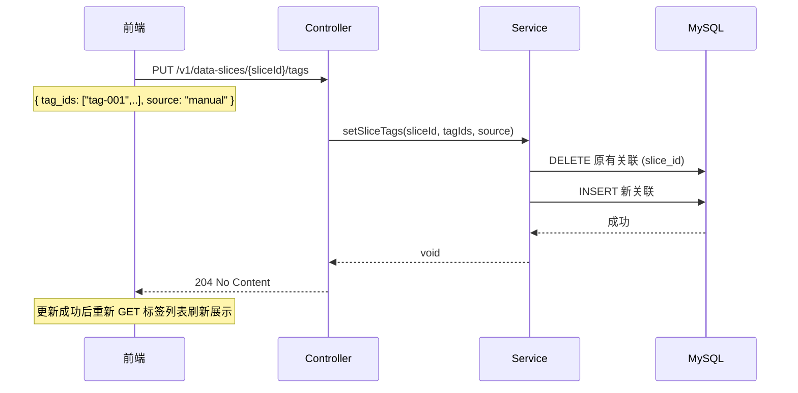

#### 前端交互建议

- **操作方式**：详情页标签区域，使用 `el-select` multiple 选择标签，保存时调用此接口
- **覆盖式更新**：接口会替换切片上所有已有标签。前端可以先 `GET /v1/data-slices/{sliceId}/tags` 获取当前标签，让用户增删后一并提交。
- **保存按钮**：修改标签后点击"保存"，调用此接口
- **保存成功后**：重新调用 `GET /v1/data-slices/{sliceId}/tags` 刷新标签展示
- **错误处理**："标签设置失败，请重试"

---

### 3.13 GET /v1/data-slices/{sliceId}/tags — 查询切片当前标签

#### 基本信息

| 项 | 值 |
|----|-----|
| 方法 | `GET` |
| 路径 | `/v1/data-slices/{sliceId}/tags` |
| 成功状态码 | `200 OK` |
| 错误状态码 | `500`（查询失败） |

#### 请求参数

| 参数 | 位置 | 类型 | 必填 | 说明 |
|------|------|------|------|------|
| `sliceId` | path | String | 是 | 切片 UUID |

#### 响应示例

**成功 200**：
```json
[
  {
    "id": "tag-005",
    "name": "夜间场景",
    "category": "时间",
    "description": "夜间时段采集的数据（18:00-06:00 UTC）",
    "created_at": "2026-07-25T00:00:00Z"
  },
  {
    "id": "tag-010",
    "name": "全传感器",
    "category": "传感器完整度",
    "description": "包含摄像头+雷达的完整传感器配置",
    "created_at": "2026-07-25T00:00:00Z"
  }
]
```

**失败 500**：
```json
{
  "error": {
    "code": "SLICE_TAGS_FAILED",
    "message": "...",
    "trace_id": "auto-generated"
  }
}
```

#### 前端交互建议

- **使用场景**：详情页加载时调用此接口获取标签，或 `GET /v1/data-slices/{sliceId}` 详情中已包含 `tags` 字段（标签名列表），此接口返回完整的标签元数据（含 id、category、description）
- **标签展示**：`el-tag` 循环展示，可附带 `category` 信息

---

### 3.14 GET /v1/health — 健康检查

#### 基本信息

| 项 | 值 |
|----|-----|
| 方法 | `GET` |
| 路径 | `/v1/health` |
| 成功状态码 | `200 OK` |

#### 响应示例

```json
{
  "status": "UP",
  "service": "dims",
  "timestamp": "2026-07-26T08:38:44.221091446Z"
}
```

#### 前端交互建议

- 此接口不需要前端主动调用，主要用于网关负载均衡的健康检测
- 对于前端，可在应用加载时用此接口快速检测后端是否可达，给出"后端服务连接异常"提示

---

## 4. 前端状态管理建议

### 4.1 Pinia Store 设计

推荐划分以下 Store：

```typescript
// stores/dataSlice.ts — 当前操作的切片
interface DataSliceStore {
  currentSliceId: string | null;
  currentSliceDetail: SliceDetail | null;
  importTaskStatus: ImportTask | null;     // 导入任务进度
  exportTaskStatus: ExportTask | null;     // 导出任务进度
}

// stores/search.ts — 检索条件与结果
interface SearchStore {
  searchParams: SearchParams;
  listResult: SliceListResponse;
  loading: boolean;
}

// stores/tag.ts — 标签库（可缓存）
interface TagStore {
  tagList: Tag[];
  lastFetchTime: number;
  loading: boolean;
}
```

### 4.2 轮询策略

```typescript
// 导入任务轮询配置
const POLL_CONFIG = {
  task: {
    interval: 2000,        // 2 秒
    backoffInterval: 5000, // 退避后 5 秒
    maxRetries: 3,         // 无变化后最多退避 3 次
    totalTimeout: 600000,  // 总超时 10 分钟
  },
  export: {
    interval: 3000,        // 3 秒
    backoffInterval: 5000,
    maxRetries: 3,
    totalTimeout: 300000,  // 总超时 5 分钟
  }
};
```

**退避逻辑**：
```typescript
let unchangedCount = 0;
let interval = POLL_CONFIG.task.interval;

function poll(taskId: string) {
  const res = await api.getTask(taskId);
  if (res.status === 'READY' || res.status === 'ERROR') {
    stopPolling();
    handleResult(res);
    return;
  }
  if (noChange(res)) {
    unchangedCount++;
    if (unchangedCount >= POLL_CONFIG.task.maxRetries) {
      interval = POLL_CONFIG.task.backoffInterval;
    }
  } else {
    unchangedCount = 0;
    interval = POLL_CONFIG.task.interval;
  }
  setTimeout(() => poll(taskId), interval);
}
```

### 4.3 错误处理统一方案

```typescript
// api/request.ts — Axios 拦截器
import axios from 'axios';
import { ElMessage } from 'element-plus';

const api = axios.create({
  baseURL: '/dims/v1',
  timeout: 60000,           // 上传接口需更长超时
});

// 请求拦截器：注入 Token 和 TraceId
api.interceptors.request.use(config => {
  config.headers['Authorization'] = `Bearer ${getToken()}`;
  config.headers['X-Trace-Id'] = generateUUID();
  return config;
});

// 响应拦截器：统一错误处理
api.interceptors.response.use(
  response => response,
  error => {
    const errData = error.response?.data?.error;
    if (errData) {
      ElMessage.error(errData.message || '请求失败');
      console.error(`[${errData.code}] ${errData.message} (trace: ${errData.trace_id})`);
    } else {
      ElMessage.error('网络异常，请检查连接');
    }
    return Promise.reject(error);
  }
);
```

### 4.4 上传特有配置

```typescript
// 上传接口需要单独配置（文件大、需进度回调）
const uploadConfig = {
  headers: { 'Content-Type': 'multipart/form-data' },
  timeout: 600000,  // 10 分钟超时
  onUploadProgress: (progressEvent: ProgressEvent) => {
    const percent = Math.round((progressEvent.loaded / progressEvent.total) * 100);
    // 更新上传进度
  }
};
```

---

## 5. 页面交互流程图

### 5.1 上传页

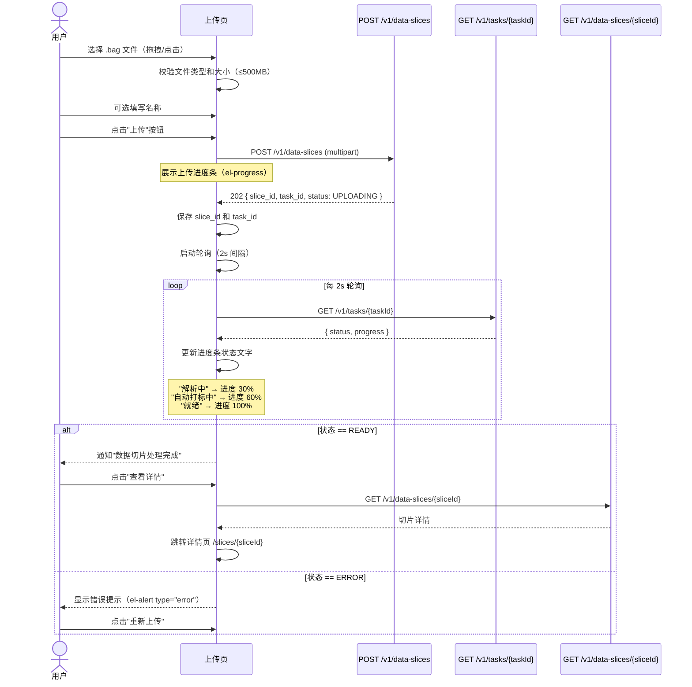

### 5.2 列表页

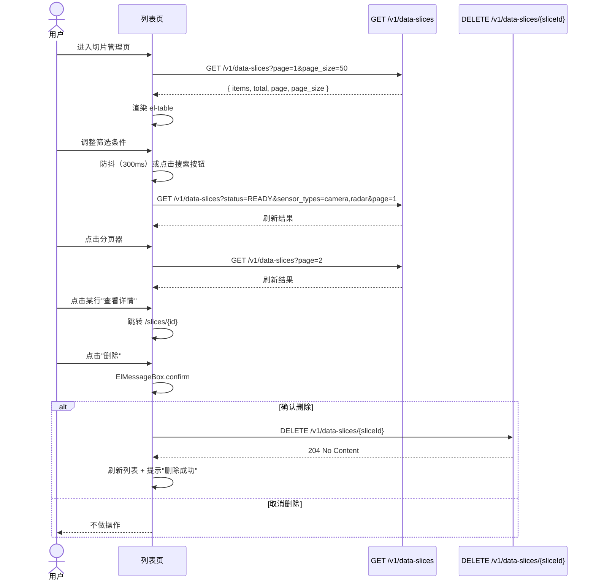

### 5.3 详情页

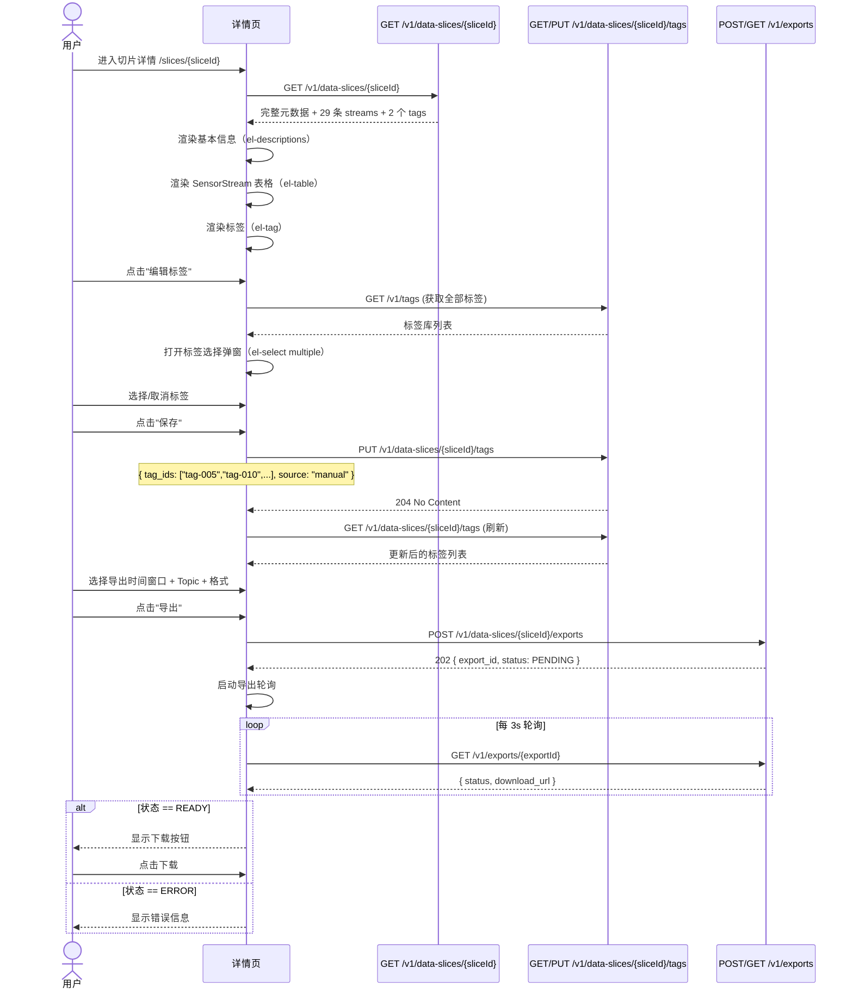

### 5.4 导出操作

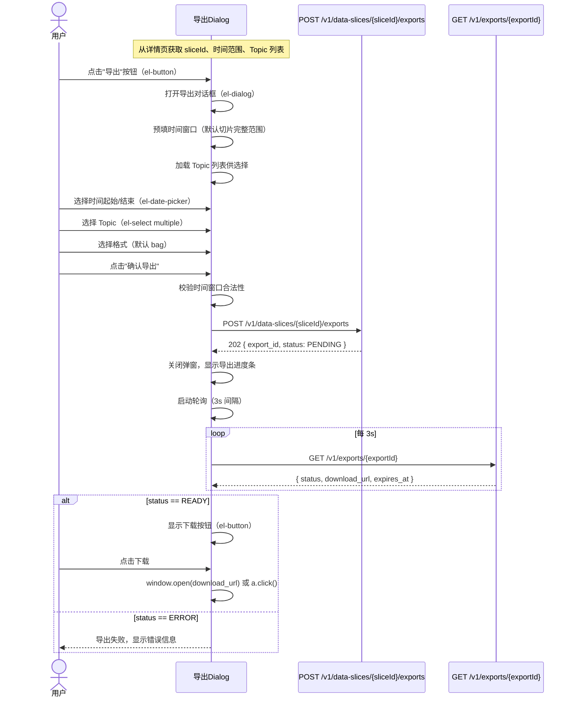

---

## 6. 数据字典

### 6.1 切片状态枚举（SliceStatus）

| 状态值 | 说明 | 前端展示文字 | el-tag 类型 |
|--------|------|-------------|------------|
| `UPLOADING` | 文件保存中 | "上传中" | warning |
| `PARSING` | 解析中（Python 解析 ROS bag 元数据） | "解析中" | warning |
| `TAGGING` | 自动打标中 | "打标中" | warning |
| `READY` | 就绪（解析+打标完成，可检索可导出） | "就绪" | success |
| `ERROR` | 处理失败 | "失败" | danger |

状态流转：
```
UPLOADING → PARSING → TAGGING → READY
    ↓          ↓         ↓
    └──────────┴─────────┴──→ ERROR
```

### 6.2 导出任务状态枚举（TaskStatus / ExportStatus）

| 状态值 | 说明 | 前端展示文字 | el-tag 类型 |
|--------|------|-------------|------------|
| `PENDING` | 等待处理 | "等待中" | info |
| `PROCESSING` | Python 裁剪导出中 | "导出中" | warning |
| `READY` | 导出完成，可下载 | "导出完成" | success |
| `ERROR` | 导出失败 | "导出失败" | danger |
| `EXPIRED` | 下载链接已过期（24h） | "已过期" | info |

### 6.3 传感器类别枚举（SensorCategory）

| 枚举值 | 中文说明 | 前端展示图标建议 |
|--------|---------|----------------|
| `camera` | 摄像头 | Camera |
| `lidar` | 激光雷达 | - |
| `radar` | 毫米波雷达 | - |
| `gnss_imu` | GNSS/IMU 定位 | - |
| `vehicle_signal` | 车辆信号（CAN/LIN） | - |
| `ultrasonic` | 超声波雷达 | - |
| `adas` | ADAS 感知结果 | - |
| `other` | 其他 | - |

### 6.4 标签分类枚举（Tag Category）

基于 SQL 种子数据的既有分类：

| 分类路径 | 说明 | 示例标签 |
|---------|------|---------|
| `场景/道路` | 道路场景类型 | highway, urban, rural |
| `环境/光照` | 光照条件 | daytime, night |
| `环境/天气` | 天气条件 | rainy, clear |
| `事件/驾驶` | 驾驶事件 | cut-in, hard-brake |
| `质量/传感器` | 传感器配置评分 | full-sensor, partial |
| `时间` | 时间段 | 夜间场景 |
| `传感器完整度` | 传感器完整度 | 全传感器 |

### 6.5 标签来源枚举（TagSource）

| 值 | 说明 |
|-----|------|
| `auto` | 自动打标（Python 规则引擎） |
| `manual` | 手动打标（用户操作） |

### 6.6 导出格式枚举（ExportFormat）

| 值 | 说明 | Phase |
|-----|------|-------|
| `bag` | ROS1 bag 格式（裁剪后的小 bag） | Phase 1 |
| `mp4` | 视频格式 | Phase 2（规划） |
| `images` | 图片序列 | Phase 2（规划） |
| `json` | JSON 格式 | Phase 2（规划） |

### 6.7 排序字段白名单

| 字段名 | 说明 |
|--------|------|
| `created_at` | 创建时间 |
| `start_ts` | 数据起始时间 |
| `end_ts` | 数据结束时间 |
| `file_size` | 文件大小 |
| `name` | 切片名称 |

### 6.8 响应字段单位说明

| 字段 | 单位 | 说明 |
|------|------|------|
| `file_size` | bytes | 文件字节数 |
| `duration_ms` | milliseconds | 时长（毫秒） |
| `frequency_hz` | Hz | 频率 |
| `msg_count` | - | 消息总数 |
| `radius` | meters | GPS 搜索半径 |
| lat/lon | degrees (WGS84) | 经纬度 |

---

## 附录 1: 集成测试验证的真实数据样例

以下数据均来自 2026-07-26 集成测试，使用真实 250MB ROS1 bag 文件（`data/mapping_input.bag`）：

| 数据项 | 实际值 |
|--------|--------|
| 切片 ID | `f9096174-f205-4979-8142-f0048f00d0c1` |
| 导入任务 ID | `f0426fb2-9f9a-4be4-b28c-977381597c96` |
| 文件大小 | 249,736,672 bytes (~238 MB) |
| 时长 | 29,996 ms (~30 秒) |
| 消息总数 | 16,527 |
| 传感器流数 | 29 条 |
| 传感器类型 | vehicle_signal, other, adas, radar, camera, gnss_imu, ultrasonic |
| 自动标签 | 夜间场景, 全传感器 |

---

## 附录 2: 已知限制

1. **导出功能**：当前 Python 层 `extract_export.py` 对自定义 ROS 消息类型（如 `perception_interface_msgs/msg/RadarPerceptionResult`）解析有限，可能导致导出失败。这是 Python 层兼容性问题，需后续修复。
2. **导出格式**：Phase 1 仅支持 `bag` 格式导出，`mp4`、`images`、`json` 计划在 Phase 2 支持。
3. **文件存储**：当前使用本地文件系统，后续将迁移至对象存储。
